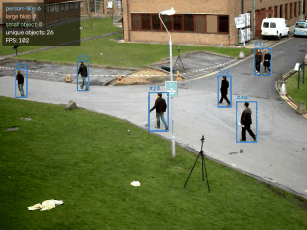
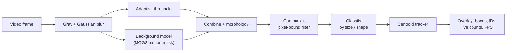
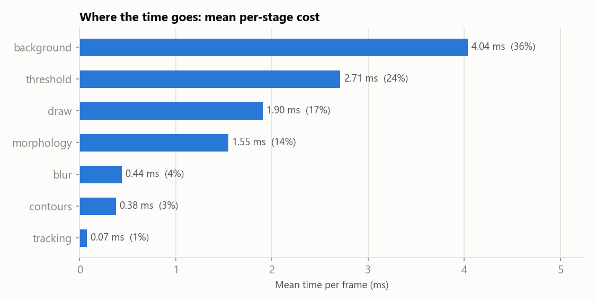
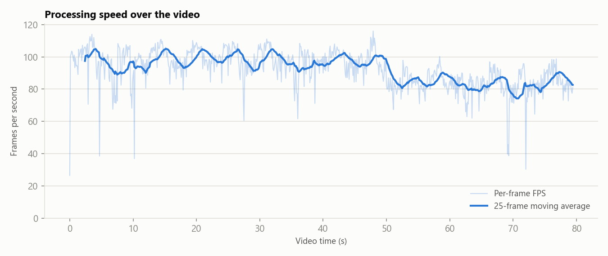
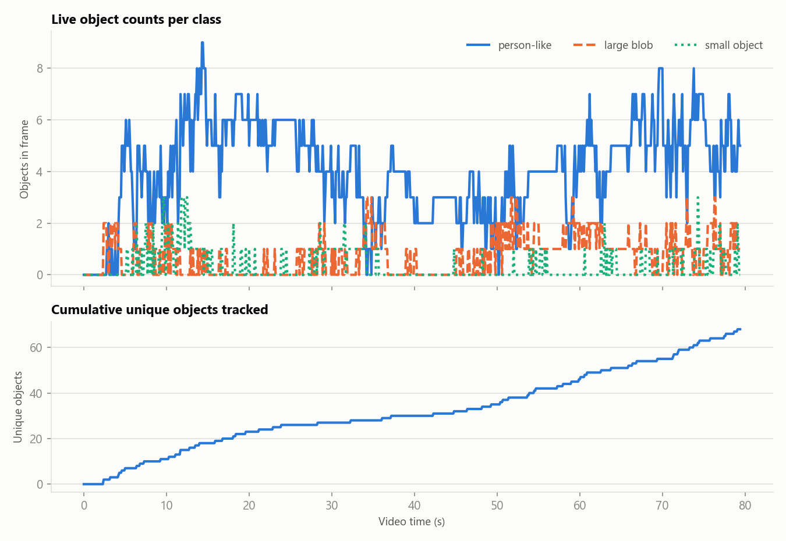
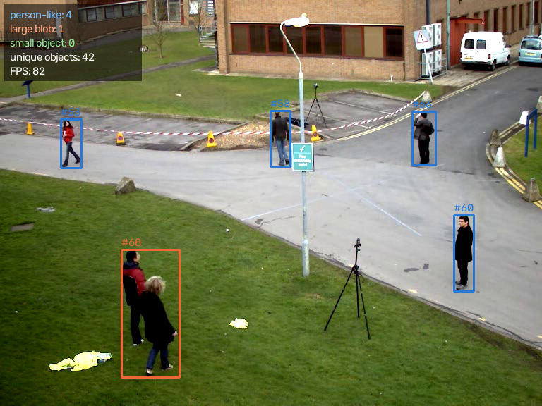
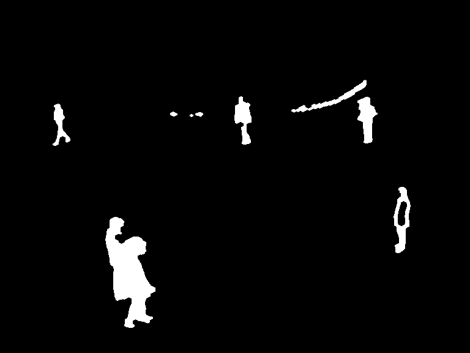
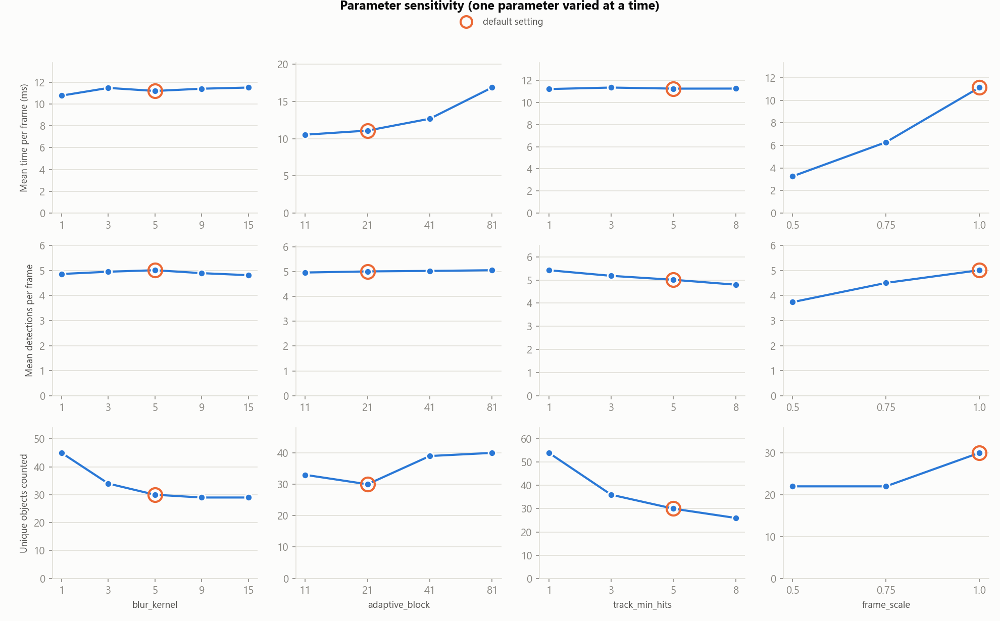

<div align="center">

# 🎥 Real-Time Object Detection and Tracking

**A real-time OpenCV pipeline that segments, detects, counts and tracks moving objects, with live per-class counts drawn on every frame.**




<sub>Boxes show object class colour and track ID; the panel shows live counts per class, unique objects and FPS.</sub>

</div>

---

## 📑 Table of Contents

- [Overview](#-overview)
- [How the pipeline works](#-how-the-pipeline-works)
- [Quick Start](#-quick-start)
- [Usage](#-usage)
- [Results](#-results)
- [Parameter study](#-parameter-study)
- [Whitepaper](#-whitepaper)
- [Limitations](#-limitations)
- [Testing](#-testing)
- [Project Structure](#-project-structure)

---

## 🔎 Overview

This project processes video (a file or a live webcam) frame by frame and, for each frame, extracts shapes, keeps
those inside defined pixel bounds, classifies them, tracks them over time and overlays dynamic counts. It also
measures how long every stage takes on every frame, so the performance of the pipeline is fully visible.

**Highlights**

- 🧪 **Classical computer vision**: Gaussian filter, adaptive threshold, background subtraction, morphology and contour analysis. No trained model, nothing to download.
- 🔢 **Dynamic count overlay** per object class, plus a running count of unique objects.
- 🧭 **Centroid tracker** gives each object a persistent ID across frames.
- ⏱️ **Per-stage, per-frame timing**: seven stages timed individually and exported to CSV.
- 📊 **Exports**: annotated video, segmentation-mask video, sample frames, metrics CSV/JSON and charts.
- 📄 **A 6-page performance whitepaper** generated from the measured results.

---

## 🛠 How the pipeline works



| Stage | What it does |
|-------|--------------|
| **1. Blur** | Grayscale + Gaussian filter to suppress noise (5×5). |
| **2. Threshold** | Adaptive Gaussian threshold: a local-contrast mask that copes with uneven lighting. |
| **3. Background** | MOG2 learns the static scene and marks pixels that move. |
| **4. Morphology** | The adaptive mask is kept inside the moving region, then closed and opened to join fragments and remove specks. |
| **5. Contours** | External contours; tiny blobs and thin streaks (e.g. fluttering tape) are rejected by pixel bounds. |
| **6. Tracking** | Nearest-centroid matching with persistent IDs; an object is reported after 5 frames, and remembered for 8 missed frames. |
| **7. Draw** | Boxes, IDs, per-class counts, unique-object count and FPS. |

**Object classes** are shape rules, not a trained classifier:

| Class | Rule |
|-------|------|
| `person-like` | taller than wide, bounding box ≤ 6000 px² |
| `large blob` | bounding box > 6000 px² (typically several people merged) |
| `small object` | everything else that passes the filters |

> Why combine thresholding with a background model? An adaptive threshold alone fires on every textured surface
> (grass, kerbs, windows). Gating it with a motion mask keeps only moving objects, filled with their own contrast edges.

---

## 🚀 Quick Start

```bash
# 1. Create and activate a virtual environment
python -m venv .venv
.venv\Scripts\activate          # Windows
# source .venv/bin/activate     # macOS / Linux

# 2. Install dependencies
pip install -r requirements.txt

# 3. Download the sample video and run the pipeline
python download_video.py
python main.py
```

---

## 💻 Usage

```bash
python main.py                              # sample video -> video, masks, metrics, charts
python main.py --source path/to/clip.mp4    # your own video
python main.py --source 0 --show            # live webcam window (press q to quit)
python main.py --max-frames 100             # quick run
python run_experiments.py                   # parameter sensitivity study (about 3 minutes)
python docs/build_whitepaper.py             # rebuild docs/Whitepaper.pdf from the results
python -m pytest                            # run tests
```

Use as a library:

```python
import cv2
from vision import Pipeline, Config

pipe = Pipeline(Config(blur_kernel=5, min_area=150))
cap = cv2.VideoCapture("data/vtest.avi")
ok, frame = cap.read()
result = pipe.process(frame)
print(result.counts, result.timings_ms["total"])   # per-class counts, total ms
cv2.imshow("annotated", result.annotated)
```

---

## 📈 Results

Input: OpenCV's sample clip `vtest.avi` (pedestrians, fixed camera, 768×576, 795 frames at 10 fps).
Hardware: Intel Core i5-1035G1 laptop CPU, no GPU.

| Metric | Value |
|--------|------:|
| Mean pipeline time per frame | 11.09 ms (std 2.11 ms) |
| Median / 95th percentile / max | 10.68 / 13.52 / 37.76 ms |
| Pipeline FPS (1000 ÷ mean time) | 90.2 |
| End-to-end FPS (including video read/write) | 51.5 |
| Real-time margin vs. the 10 fps source | 9.0× |
| Mean objects detected per frame | 5.1 (max 10) |
| Unique objects tracked (estimate) | 68 |

> Timings on a laptop vary between runs: three identical full runs gave mean frame times of 10.7, 11.1 and 11.7 ms.

### Where the time goes



The background model (36%) and adaptive threshold (24%) dominate; drawing takes 17% and tracking under 1%.

### Frame-by-frame behaviour

| Speed over the video | Counts over time |
|---|---|
|  |  |

Full per-frame data (all stage times, counts, unique objects): [`results/frame_metrics.csv`](results/frame_metrics.csv).

### Segmentation example

Annotated frame and its segmentation mask (all sampled frames are in [`results/frames/`](results/frames)):

| Annotated | Mask |
|---|---|
|  |  |

### Manual sanity check

The clip has no ground-truth labels, so people were counted by eye in the raw frames at nine evenly spaced
positions (every 80th frame) and compared with the detector ([`docs/manual_counts.csv`](docs/manual_counts.csv)).

| | People counted by eye | Objects detected |
|---|---:|---:|
| Total over 9 frames | 54 | 48 |

Mean absolute difference 0.67 objects per frame; exact match in 4 of 9 frames. The detector reports fewer objects
than people because touching or occluded people merge into one blob. This is a small, single-observer check, not a
rigorous accuracy measurement.

---

## 🔬 Parameter study

One parameter varied at a time on the first 400 frames ([`results/experiments.csv`](results/experiments.csv)):



| Finding | Evidence |
|---------|----------|
| **Frame scale is the strongest speed lever** | 11.1 ms at full size, 3.3 ms at half size, but detections per frame fall from 5.0 to 3.7 (small, distant people drop below the size thresholds) |
| **Large adaptive-threshold windows are costly** | 16.9 ms with an 81 px window vs 11.1 ms with 21 px, with almost no change in detections |
| **Blur barely affects speed** | Stronger blur reduces fragmentation: unique count 45 with no blur vs 29 with a 15×15 kernel |
| **Track confirmation drives the unique count** | 54 unique objects when reporting immediately vs 26 when requiring 8 frames, so the unique-object figure is an estimate, not a head count |

---

## 📄 Whitepaper

A 6-page performance whitepaper covering the method, the experimental setup, frame-by-frame inference metrics,
the manual check, the parameter study and limitations:
**[`docs/Whitepaper.pdf`](docs/Whitepaper.pdf)**. It is generated by `docs/build_whitepaper.py`, which reads every
number from the saved results.

---

## ⚠️ Limitations

- **Static camera assumed**: a moving camera or sudden lighting change floods the motion mask.
- **Only moving objects are detected.**
- **Classes are shape heuristics**, not semantic labels.
- **Merged and occluded objects** count as one blob, and IDs can restart after long occlusions (position-only tracker).
- **Evaluation is small**: one clip, no ground truth, a nine-frame manual check by one observer.
- Timings come from one laptop and vary by roughly 10% between runs.

**Ideas for improvement:** add a pre-trained detector such as YOLO for semantic classes and better separation of
touching people, use a Kalman filter or appearance features in the tracker, split merged blobs with a watershed
step, and evaluate on a labelled tracking benchmark.

---

## ✅ Testing

```bash
python -m pytest
```

15 tests cover the tracker (ID persistence, closest-pair matching, flicker rejection, track expiry), the pipeline
(detecting and tracking a moving object, empty scenes, shape filter, warm-up, well-formed outputs), and the video
runner (rows, summary statistics, output files, error handling). Tests use small synthetic clips, so they don't
need the downloaded video.

---

## 📁 Project Structure

```
Real-Time-Object-Detection-and-Tracking/
├── main.py                 # run the pipeline, export video, masks, metrics, charts
├── run_experiments.py      # parameter sensitivity study
├── download_video.py       # fetch the sample video
├── vision/
│   ├── pipeline.py         # the seven-stage segmentation/detection pipeline
│   ├── tracker.py          # centroid tracker
│   ├── runner.py           # video loop, per-frame metrics, summary
│   ├── charts.py           # charts
│   └── demo.py             # demo GIF
├── docs/
│   ├── Whitepaper.pdf      # 6-page performance whitepaper
│   ├── build_whitepaper.py # generates the PDF from results
│   └── manual_counts.csv   # manual sanity-check data
├── results/                # charts, metrics, sample frames, demo GIF
├── tests/                  # unit tests
└── requirements.txt        # pinned dependencies
```

The annotated and mask videos (`results/annotated.mp4`, `results/mask.mp4`, about 25 MB) are generated by
`python main.py` and are not stored in the repository.

Built with Python 3.10 · OpenCV · NumPy · Matplotlib · ReportLab · pytest
